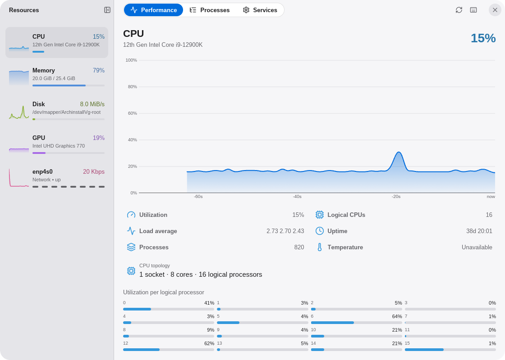
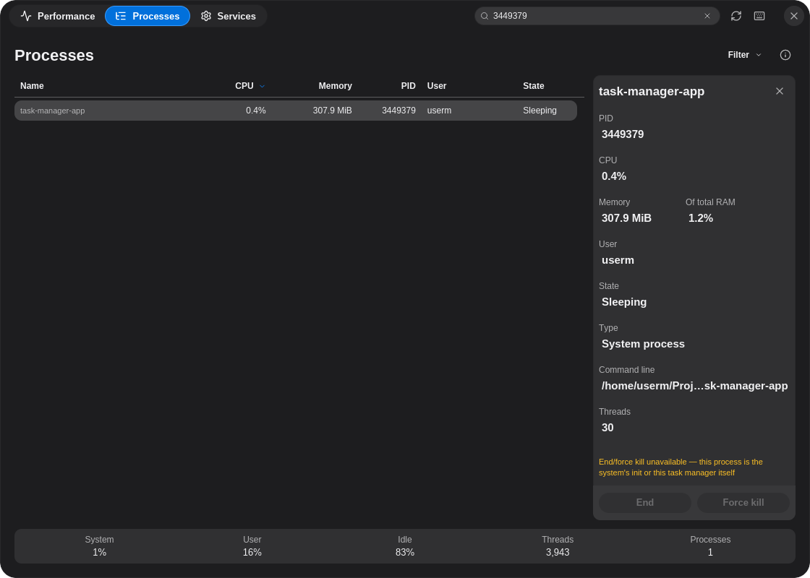
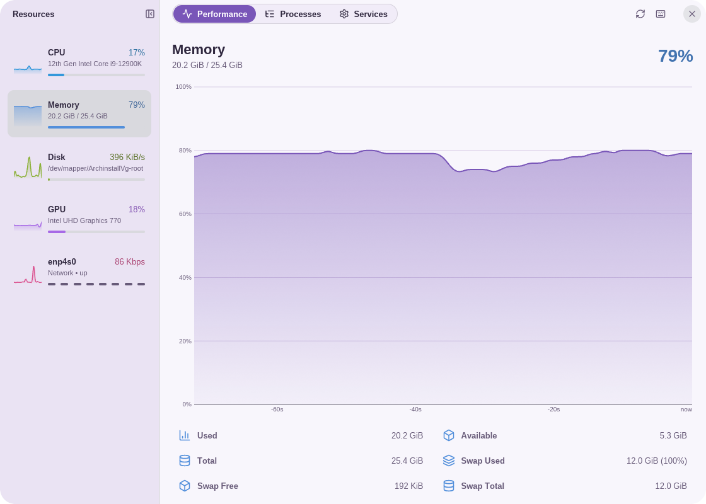
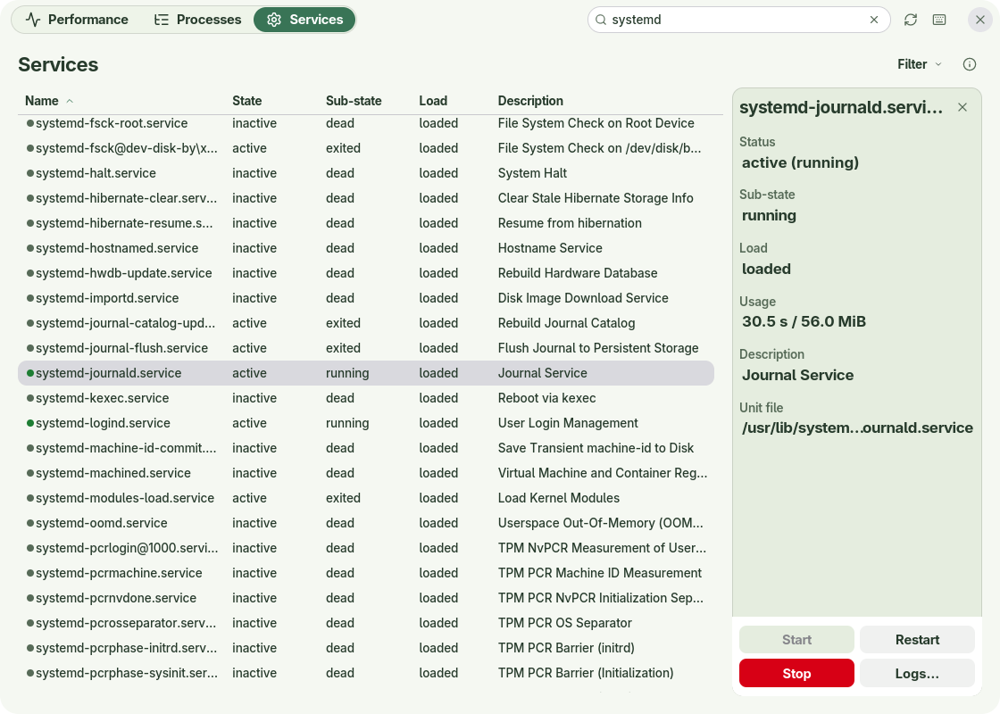
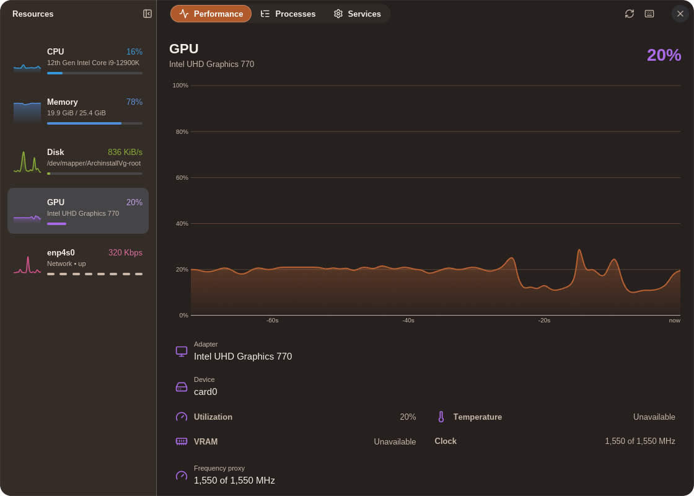
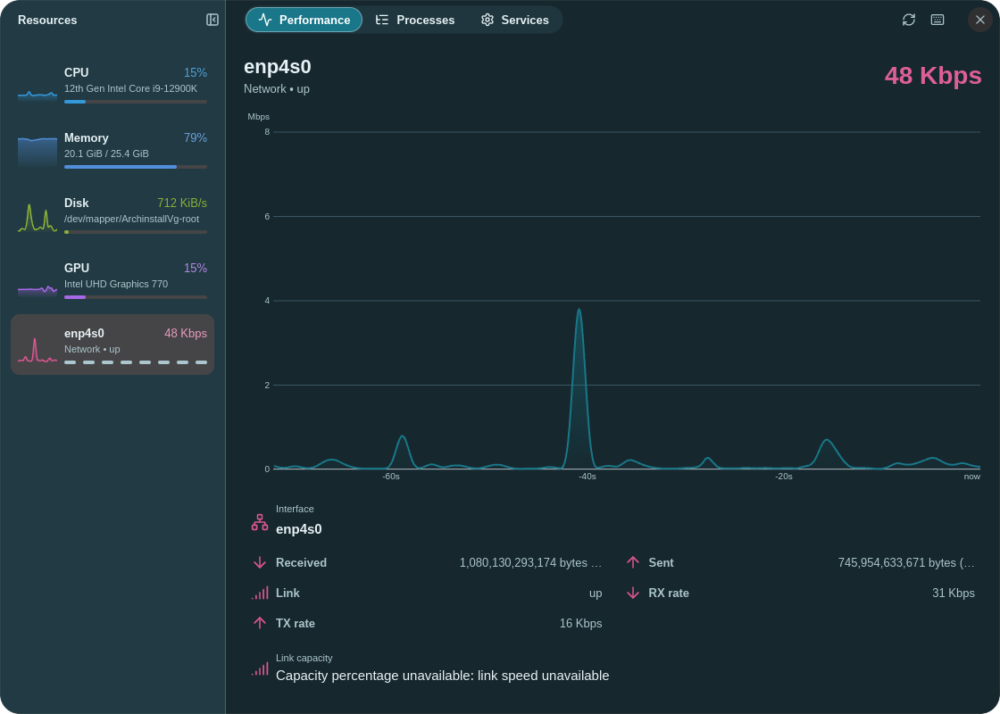
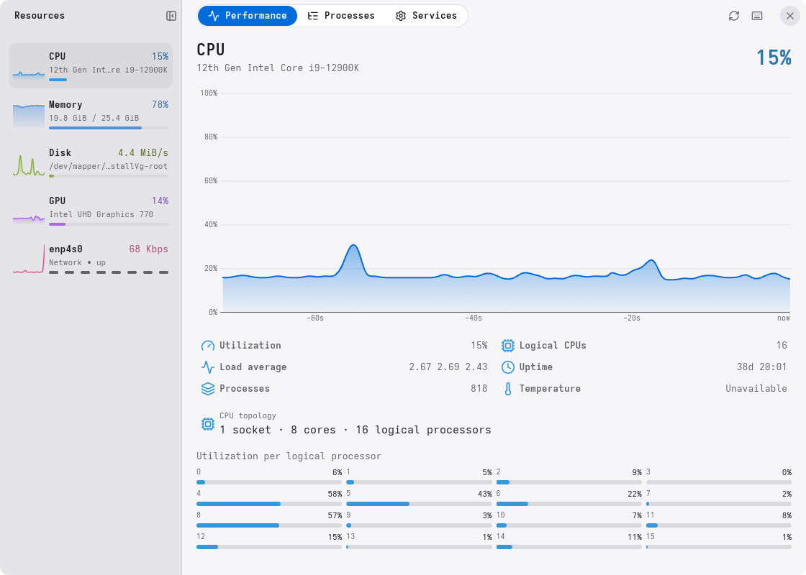
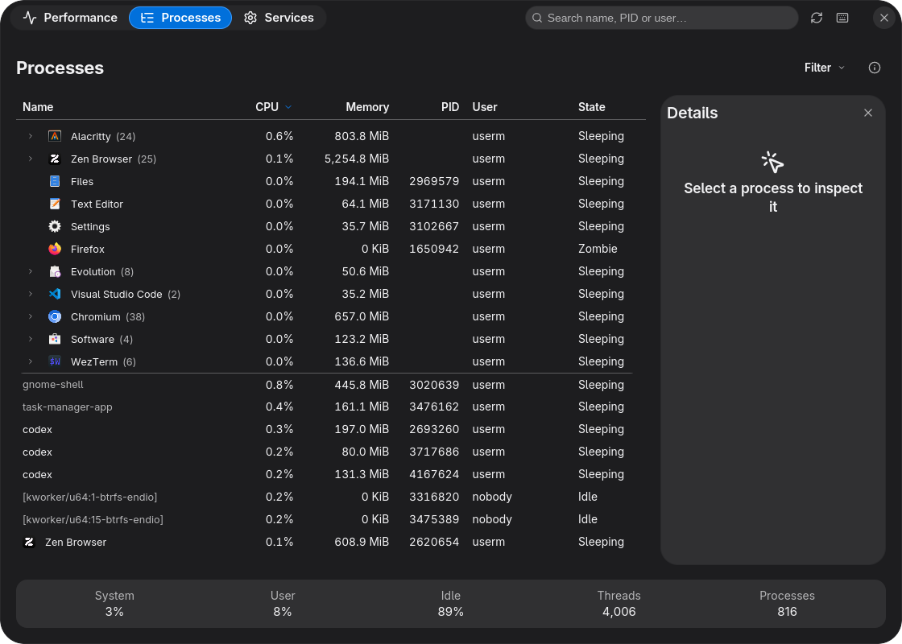

# Task Manager

Inspect applications, processes, services and system performance. Built with [enzUI](https://github.com/enz1m/enzui).

<table>
  <tr>
    <td align="center"><a href="docs/screenshots/basic-light.png"></a><br><sub>CPU · light</sub></td>
    <td align="center"><a href="docs/screenshots/basic-dark.png"></a><br><sub>Process details · dark</sub></td>
    <td align="center"><a href="docs/screenshots/lavender.png"></a><br><sub>Memory</sub></td>
    <td align="center"><a href="docs/screenshots/sage.png"></a><br><sub>Services</sub></td>
  </tr>
  <tr>
    <td align="center"><a href="docs/screenshots/ember.png"></a><br><sub>GPU</sub></td>
    <td align="center"><a href="docs/screenshots/lagoon.png"></a><br><sub>Network</sub></td>
    <td align="center"><a href="docs/screenshots/precision.png"></a><br><sub>CPU</sub></td>
    <td align="center"><a href="docs/screenshots/comfort.png"></a><br><sub>Processes</sub></td>
  </tr>
</table>

Click a screenshot to enlarge.

## Features

- Live CPU, memory, network, disk and available GPU graphs.
- Grouped applications, searchable processes and detailed resource usage.
- Identity-checked process actions and a systemd services browser.

## Build and run

Use Rust **1.99.1** (minimum **1.95**), a C/C++ toolchain and pkg-config.
Linux UI builds need Wayland/XKB, GLib/GIO, fontconfig and Vulkan/EGL development support.

```sh
git clone https://github.com/enz1m/task-manager.git
cd task-manager
cargo build --locked
cargo run --locked
```

Dependencies pin public [enzUI Alpha 0.1](https://github.com/enz1m/enzui/releases/tag/v0.1.0-alpha.1)
and its matching public foundation forks. No sibling framework checkout is needed.
Wayland is enabled by default; use `--features x11` when X11 support is needed.
Use `cargo build --release --locked` for an optimized binary.

## Files and desktop integration

Task Manager does not register document formats. It reads Linux process and system information; destructive actions require an explicit user action.

## Requirements and limits

Sensor and GPU information depends on kernel/driver support and permissions. System services need systemd. Elevated actions follow the host authorization policy; unavailable values are shown rather than invented.

Shared enzUI theme settings apply live. Translations are under `assets/locales`;
locale coverage varies.

## Development

```sh
cargo fmt --all -- --check
ICED_TEST_BACKEND=software cargo test --locked --all-targets -- --test-threads=1
cargo clippy --locked --all-targets -- -D warnings
```

Keep tests for durable workflows, data integrity, resource ownership and security
boundaries. See [contributing](CONTRIBUTING.md).

Licensed under [MIT](LICENSE); retained dependency notices and licenses apply to
third-party code and assets.
